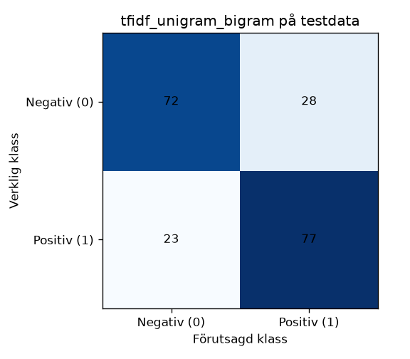
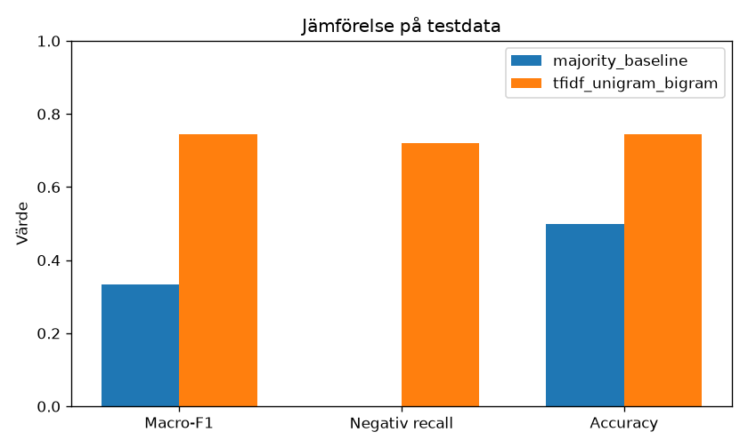

# Klassificering av restaurangomdömen

## Problem och syfte

En restaurangansvarig kan behöva gå igenom många omdömen för att hitta
missnöjda gäster och återkommande problem. Projektet undersöker om
recensionernas text kan användas för att klassificera engelska
restaurangomdömen som positiva eller negativa.

Vi jämför en majoritetsbaseline med TF-IDF och logistisk regression.
Syftet är att utvärdera om textanalys ger bättre resultat än att alltid
välja den vanligaste klassen.

## Målgrupp och avgränsning

Den tänkta användaren är en restaurangansvarig som vill ha stöd vid
manuell genomgång av omdömen.

Projektet är en lokal prototyp för korta engelska recensionstexter.
Det omfattar inte svenska recensioner, en neutral klass, automatisk
publicering eller automatiska svar till gäster. Modellen ska inte
ensam avgöra vilka omdömen som behöver uppmärksammas.

## Gruppmedlemmar och planering

- Soroush Gholamreza
- Josefina Nadafan

Arbetsuppgifter, ansvar och progression följs i
[GitHub Projects](https://github.com/users/SoroushGReza/projects/17).

## Datakälla och användningsvillkor

Vi använder Yelp-delen av **Sentiment Labelled Sentences**, skapad av
Dimitrios Kotzias och publicerad av UCI Machine Learning Repository.

Källhänvisning: Kotzias, D. (2015). Sentiment Labelled Sentences [Dataset].
UCI Machine Learning Repository.
https://doi.org/10.24432/C57604

Datasetets licens är **CC BY 4.0**. Ursprung, hämtningstidpunkt,
användningsvillkor och kontroller beskrivs i
[datakälledokumentationen](docs/data_source.md).

Originalmaterialet innehåller 1 000 meningar med etikett 0 för negativ
och 1 för positiv. Efter dubbletthanteringen återstår 996 meningar.
Amazon- och IMDb-delarna används inte.

## Installation och utvecklingsmiljö

Instruktionerna gäller Windows med PowerShell i VS Code.

### Förutsättningar

- Git.
- Python enligt versionen i `python-version.txt`.
- VS Code med tillägget Python från Microsoft.
- Åtkomst till projektets GitHub-repository.

Paketversionerna finns i `requirements.txt`. Varje gruppmedlem skapar
en egen lokal virtuell miljö i `.venv`.

### 1. Hämta projektet

Vid första installationen:

```powershell
git clone https://github.com/SoroushGReza/restaurangomdomen-ml.git
cd restaurangomdomen-ml
```

Öppna projektmappen i VS Code.

Om projektet redan är klonat, öppna den befintliga projektmappen
och hämta senaste versionen:

```powershell
git pull --ff-only origin main
```

### 2. Skapa en virtuell miljö

Kör från projektroten. Kontrollera Pythonversionen mot
`python-version.txt` innan miljön skapas.

```powershell
python --version
python -m venv .venv
```

### 3. Installera projektets beroenden

```powershell
.\.venv\Scripts\python.exe -m pip install --upgrade pip
.\.venv\Scripts\python.exe -m pip install -r requirements.txt
```

Kommandona använder Python från projektets virtuella miljö direkt.

### 4. Kontrollera installationen

```powershell
.\.venv\Scripts\python.exe -m pip check
```

Förväntat resultat:

```text
No broken requirements found.
```

Kontrollera också att projektets paket kan importeras:

```powershell
.\.venv\Scripts\python.exe -c "import pandas, sklearn, matplotlib, joblib, pytest; print('Environment ready')"
```

Förväntat resultat:

```text
Environment ready
```

### 5. Välj miljön i VS Code

1. Tryck `Ctrl + Shift + P`.
2. Välj `Python: Select Interpreter`.
3. Välj `.venv\Scripts\python.exe`.

### Fortsatt arbete

Den virtuella miljön skapas en gång per dator.

Hämta senaste ändringarna inför ett nytt arbetspass:

```powershell
git pull --ff-only origin main
```

Om `requirements.txt` har ändrats, uppdatera miljön:

```powershell
.\.venv\Scripts\python.exe -m pip install -r requirements.txt
```

Ta en ledig issue, tilldela den till dig själv och flytta den till
`In progress`. Dokumentera framsteg och eventuella hinder i issuen.

### Projektstruktur

| Mapp               | Innehåll                                              |
| ------------------ | ----------------------------------------------------- |
| `src/`             | Kod för datahantering, modeller, utvärdering och demo |
| `data/raw/`        | Lokala originaldata                                   |
| `data/processed/`  | Lokala bearbetade data                                |
| `data/splits/`     | Lokala tränings-, validerings- och testdata           |
| `models/`          | Lokalt sparade modeller                               |
| `reports/`         | Analyser och dokumenterade resultat                   |
| `reports/figures/` | Diagram och resultatfigurer                           |
| `docs/`            | Datakälla, beslut, risker och AI-användning           |
| `tests/`           | Automatiska tester                                    |

`.gitkeep` används för att tomma projektmappar ska följa med i Git.
`.gitignore` håller virtuella miljöer, lokala dataset, genererade
modeller och hemliga miljövariabler utanför versionshanteringen.

### Projektets körning

### Sammanhängande körflöde

Kör från projektroten med projektets virtuella miljö:

```powershell
.\.venv\Scripts\python.exe src/run_pipeline.py
```

Kommandot kör befintliga skript i följande ordning:

1. `load_data.py`: läser och kontrollerar originaldatan.
2. `prepare_data.py`: förbereder data och skriver datakvalitetsrapport.
3. `split_data.py`: skapar tränings-, validerings- och testdelar.
4. `train_baseline.py`: tränar och sparar majoritetsbaseline.
5. `train_model.py`: tränar textmodeller och väljer modell på valideringsdata.

Om originaldatan saknas kan den hämtas i samma körning:

```powershell
.\.venv\Scripts\python.exe src/run_pipeline.py --download
```

Flödet använder samma Pythonmiljö för alla steg och avbryts om ett steg
misslyckas. Saknad originaldata ger instruktion om att använda `--download`.

Vid omkörning skrivs bearbetade data, uppdelningar, modeller och
valideringsrapporter över. Samma data, beroenden och inställningar ska
användas för att reproducera resultatet. Modellinställningarna ändras
inte utifrån sluttestets resultat.

Testdelen skapas vid uppdelningen men används inte för träning eller
modellval. Slututvärdering ingår inte i körflödet utan körs uttryckligen
med den sparade modellen:

```powershell
.\.venv\Scripts\python.exe src/final_evaluation.py
```

Tester för körflödet kontrollerar stegens ordning, Pythonmiljö,
felhantering och att slututvärdering inte startas automatiskt.

### Läsa in Yelp-data

Hämtning, uppackning och kontroll av datakällan beskrivs i
`docs/data_source.md`. Kör från projektroten:

```powershell
.\.venv\Scripts\python.exe src/load_data.py --download
.\.venv\Scripts\python.exe src/load_data.py
.\.venv\Scripts\python.exe -m pytest
```

`--download` hämtar UCI-arkivet och sparar `data/raw/yelp_labelled.txt`
lokalt och oförändrad. Nästa kommando läser in filen och kontrollerar
1 000 rader och 500 recensioner per klass.

### Kontrollera datakvalitet

```powershell
.\.venv\Scripts\python.exe src/prepare_data.py
```

Kommandot läser den lokala Yelp-filen, tar bort exakta dubbletter och
skriver `data/processed/reviews.csv` samt `reports/data_quality.md`.
Originaltexten behålls. Nära dubbletter får ett gemensamt grupp-ID.

### Dela data

```powershell
.\.venv\Scripts\python.exe src/split_data.py
```

Kommandot läser `data/processed/reviews.csv` och skriver
`data/splits/train.csv`, `data/splits/validation.csv` och
`data/splits/test.csv`. Uppdelningen använder `random_state=42`,
stratifieras på klass och håller samma `duplicate_group_id` i en delmängd.
Analysen skrivs till `reports/data_summary.md`.

### Majoritetsbaseline (uppgift 05)

`src/train_baseline.py` väljer den vanligaste klassen enbart från
`data/splits/train.csv`. Vid lika antal väljs klass `0`.
Recensionernas text används inte. Valideringsetiketterna påverkar inte
vilken klass som väljs.

Körningen förutsätter att den granskade datauppdelningen är klar och att
hanteringen av eventuella personuppgifter är avstämd enligt skolans krav.
Kör därefter från projektroten:

```powershell
.\.venv\Scripts\python.exe src/train_baseline.py
```

Kommandot skapar:

- `models/baseline.json`: vald klass och träningsmaterialets klassantal.
- `data/processed/baseline_validation_predictions.csv`: en prediktion per
  valideringsrad, med kolumnerna `review_id`, `y_true`, `y_pred`, `model` och `split`.
- `reports/baseline.md`: metod, klassantal och information om utdata.

Modellfilen och prediktionerna sparas lokalt och omfattas av befintlig
`.gitignore`. Rapporten versionshanteras efter körningen på projektets data.

Baseline ger en jämförelsenivå för att undersöka om textanalys förbättrar
klassificeringen. Mätvärden beräknas i den gemensamma utvärderingen.
Testdata läses inte av träningskommandot. Vid sluttestet kan
`load_baseline` och `predict_baseline` återanvända den sparade klassen
utan att anpassa modellen igen.

Testa baseline separat:

```powershell
.\.venv\Scripts\python.exe -m pytest tests/test_train_baseline.py -q
```

Testerna använder syntetiska testfall och kräver inga Yelp-filer.
De kontrollerar bland annat majoritetsval, lika klassantal, prediktionsformat,
överlapp mellan delmängder och återanvändning av sparad baseline.
Syntetiska testfall används endast för kodkontroll; projektets resultat
ska baseras på Yelp-datan.

### TF-IDF och logistisk regression (uppgift 06)

`src/train_model.py` jämför två textmodeller:

- TF-IDF med enskilda ord: `ngram_range=(1, 1)`.
- TF-IDF med enskilda ord och ordpar: `ngram_range=(1, 2)`.

Båda använder en scikit-learn Pipeline med TfidfVectorizer och
LogisticRegression. Endast recensionens text används som indata.
TF-IDF och klassificeraren anpassas enbart till träningsmaterialet.

Gemensamma inställningar är `C=1.0`, `max_iter=1000`,
`random_state=42` och `stop_words=None`.

Kör efter dataförberedelsen och uppdelningen:

```powershell
.\.venv\Scripts\python.exe src/train_model.py
```

Modellerna jämförs på samma valideringsdata. Högst macro-F1 avgör
modellvalet. Vid lika värde väljs högre recall för negativa recensioner
(klass 0), därefter den enklare modellen med enskilda ord.

Majoritetsbaseline utvärderas också på samma valideringsrader.
Dess majoritetsklass beräknas från samma träningsetiketter som tidigare.

Kommandot skapar:

- `models/tfidf_logistic_regression.joblib`: den valda, tränade pipelinen.
- `data/processed/tfidf_unigram_validation_predictions.csv`:
  valideringsprediktioner för enskilda ord.
- `data/processed/tfidf_unigram_bigram_validation_predictions.csv`:
  valideringsprediktioner för enskilda ord och ordpar.
- `data/processed/model_validation_predictions.csv`:
  valideringsprediktionerna från den valda modellen.
- `reports/model_selection.md`: inställningar, underlag,
  valideringsresultat, jämförelse med baseline och modellval.

Prediktionsfilerna använder samma kolumner som baseline:
`review_id`, `y_true`, `y_pred`, `model` och `split`.

Modell och prediktioner sparas lokalt och ignoreras av Git.
Rapporten versionshanteras.

Den sparade pipelinen förblir tränad enbart på träningsdelen.
Ingen omträning på tränings- och valideringsdata tillsammans görs.
Testdata läses inte av detta kommando. Vid sluttestet ska den sparade
pipelinen återanvändas utan ny träning.

### Gemensamma mått för modellval

`src/evaluate.py` innehåller `evaluate_predictions`, som används för
både baseline och textmodellerna.

Funktionen matchar prediktioner mot facit via `review_id` och kontrollerar
bland annat saknade eller duplicerade ID:n, felaktigt facit och ogiltiga
prediktioner.

Den beräknar:

- Macro-F1: genomsnittet av F1 för klass 0 och klass 1.
- Negativ recall: andelen negativa recensioner som klassificeras korrekt.

Odefinierade mått sätts till 0. Accuracy, precision, recall och F1 per klass
samt confusion matrix ingår i samma funktion och beskrivs under slututvärderingen.

### Tester

Kör testerna för baseline, textmodell och modellval:

```powershell
.\.venv\Scripts\python.exe -m pytest tests/test_train_baseline.py tests/test_train_model.py -q
```

Dessa tester använder syntetiska exempel och kräver inte originaldatasetet.
De kontrollerar bland annat mått mot handräknade värden, modellvalets
prioriteringsordning, skydd mot dataläckage, prediktionsformat och
återladdning av sparad modell.

Kör hela testsviten efter att originaldatasetet har hämtats:

```powershell
.\.venv\Scripts\python.exe -m pytest -q
```

Vid den genomförda lokala kontrollen passerade samtliga 60 tester.

### Resultat och återstående utvärdering

Efter borttagning av fyra dubbletter återstår 996 recensioner:

- Träning: 597.
- Validering: 199.
- Test: 200.

Majoritetsbaseline väljer klass 1 utifrån 298 negativa och 299 positiva
träningsrecensioner. Modellvalet på valideringsdata valde
`tfidf_unigram_bigram`.

Detaljerade resultat finns i `reports/baseline.md` och
`reports/model_selection.md`. Valideringsresultaten används för modellval
och ska inte tolkas som oberoende sluttestresultat.

Slututvärdering på testdata och demonstration beskrivs nedan.
Felanalys och risker finns i `reports/error_analysis.md` och `docs/risks.md`.
Valideringsresultaten ska inte tolkas som oberoende sluttestresultat.

På den separata testmängden med 200 recensioner blev resultaten:

| Modell | Macro-F1 | Negativ recall | Accuracy |
| --- | --- | --- | --- |
| Majoritetsbaseline | 0,333333 | 0,00 | 0,500 |
| TF-IDF med ord och ordpar + logistisk regression | 0,744841 | 0,72 | 0,745 |

Textmodellen klassificerade 149 av 200 recensioner korrekt.
Den missade 28 av 100 negativa recensioner och klassificerade
23 av 100 positiva recensioner som negativa.

Textmodellen förbättrar samtliga redovisade testmått jämfört med baseline,
men behöver fortfarande mänsklig granskning. Resultaten gäller detta
begränsade engelskspråkiga underlag och visar inte hur modellen fungerar
på svenska eller på andra restaurangdata.

### Rapporter och figurer

- [Datakvalitet](reports/data_quality.md)
- [Datauppdelning](reports/data_summary.md)
- [Majoritetsbaseline](reports/baseline.md)
- [Modellval på valideringsdata](reports/model_selection.md)
- [Slututvärdering](reports/results.md)
- [Testmått som CSV](reports/metrics_test.csv)
- [Felanalys](reports/error_analysis.md)
- [Risker och reservplaner](docs/risks.md)





### Slututvärdering (uppgift 07 och 08)

`src/evaluate.py` beräknar macro-F1, negativ recall, accuracy samt precision,
recall och F1 per klass. Confusion matrix har klassordningen `[0, 1]`,
med verklig klass på raderna och förutsagd klass i kolumnerna.
Prediktioner matchas via `review_id`.

När modellvalet är låst körs de sparade modellerna på testdata:

```powershell
.\.venv\Scripts\python.exe src/final_evaluation.py
```

Kommandot tränar inte om modellerna och skriver:

- `reports/metrics_test.csv`: enbart testresultat.
- `reports/results.md`: metod, inställningar, jämförelse och begränsningar.
- `reports/figures/`: confusion matrix för respektive modell och ett jämförelsediagram.

Modellinställningarna ändras inte efter att testresultatet har setts.

### Felanalys och risker (uppgift 11)

`reports/error_analysis.md` går igenom felklassificeringar från den befintliga
testmängden med den sparade textmodellen. Modellen tränas inte om, och
testuppdelningen ändras inte.

`docs/risks.md` beskriver risker för dataurval, personuppgifter, praktisk
användning och reproducerbarhet.

### Demonstration av en ny recension

`src/predict.py` laddar den sparade TF-IDF-pipelinen och klassificerar en
engelsk recension som `positiv` eller `negativ`. Modellen har ingen neutral
klass och tränas inte om. Exemplen nedan är illustrationer och ingår inte i
den uppmätta testprestandan.

```powershell
.\.venv\Scripts\python.exe src/predict.py "The food was fresh and the service was excellent."
.\.venv\Scripts\python.exe src/predict.py "The meal was cold and the waiter ignored us."
.\.venv\Scripts\python.exe src/predict.py "The food was fine but we waited a long time."
```

Utan argument frågar programmet efter texten. Tom eller blank text ger ett
felmeddelande. Vid en lokal körning blev svaren `positiv`, `negativ` och
`negativ`. De svaren är illustrationer och ingår inte i testresultatet.

Om modellfilen saknas visar programmet ett felmeddelande med instruktion
om att skapa modellen genom körflödet:

```powershell
.\.venv\Scripts\python.exe src/run_pipeline.py
```

Tom eller enbart blank text avvisas innan modellen laddas.
Vid tom text eller saknad modell avslutas kommandot med felkod 2.

En annan lokal modellfil kan anges med `--model`:

```powershell
.\.venv\Scripts\python.exe src/predict.py "Great food and friendly service." --model models/tfidf_logistic_regression.joblib
```

### Användning av generativ AI

Generativ AI har använts som stöd för planering, kodgranskning och dokumentation.

Mer information om stödet och kontrollerna finns i
[docs/ai_usage.md](docs/ai_usage.md).
